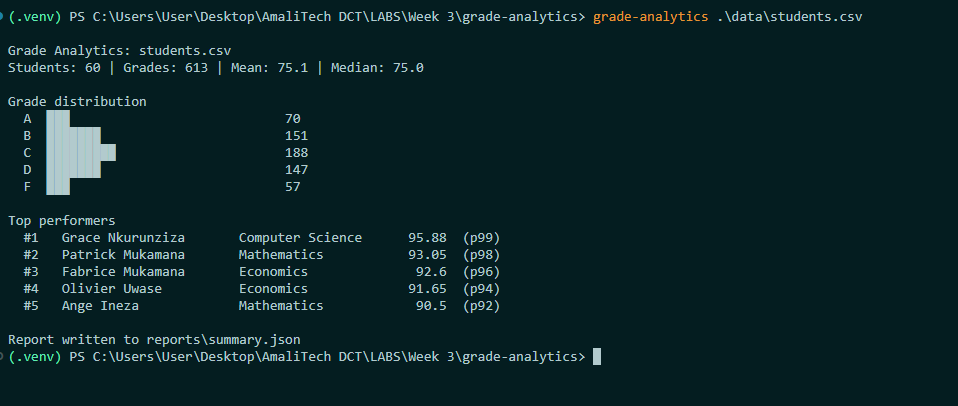

# Student Grade Analytics Tool

A command-line tool and Python library that reads student grade records from CSV, computes statistics (distributions, averages, medians, modes, percentile rankings and trends) and writes a structured JSON report.

Built for the **Python Advanced** module to practise the `collections` module, `dataclasses`, type hints, `pathlib` and file I/O with context managers.



## Features

- Loads grade records from CSV with `pathlib` and `csv.DictReader`, with clear errors for missing files, permission problems, wrong encodings and invalid rows (with line numbers).
- Models students, courses, grades and rankings with `dataclasses` and `NamedTuple`.
- Aggregates data with `Counter`, `defaultdict`, `OrderedDict` and `deque`.
- Computes mean, median, mode and percentile rank, implemented from scratch and verified against Python's `statistics` module.
- Ranks students with tie-aware competition ranking (1, 2, 2, 4).
- Tracks each student's performance over semesters with a rolling average.
- Writes a JSON report whose structure is defined with `TypedDict`.
- Fully type-hinted: passes `mypy --strict`. No runtime dependencies beyond the standard library.

## Requirements

- Python 3.11 or newer
- `pytest` and `mypy` for development (installed via `requirements.txt`)

## Setup

```bash
git clone https://github.com/B-Pine/grade-analytics.git
cd grade-analytics

python -m venv .venv
source .venv/bin/activate          # Windows: .venv\Scripts\activate

pip install -r requirements.txt
```

`requirements.txt` also installs the project itself in editable mode (`-e .`), which makes the `grade-analytics` command available and lets code changes take effect without reinstalling.

## Usage

### Command line

```bash
grade-analytics data/students.csv
grade-analytics data/students.csv -o reports/summary.json --top 10
```

| Option | Default | Description |
|---|---|---|
| `csv` | (required) | Path to the grades CSV file |
| `-o`, `--output` | `reports/summary.json` | Where to write the JSON report |
| `--top` | `5` | Number of top performers to include (must be 1 or more) |

The tool can also be run as `python -m grade_analytics data/students.csv`, which works even when the `grade-analytics` command isn't on your PATH.

**Exit codes:** `0` on success, `1` if the data couldn't be processed (the error is printed to stderr), `2` for invalid arguments.

### As a library

```python
from grade_analytics.file_io import load_students, write_report
from grade_analytics.reports import build_summary
from grade_analytics.analytics import rank_students, student_trend

students = load_students("data/students.csv")

for entry in rank_students(students)[:3]:
    print(entry.rank, entry.student.name, round(entry.average, 2))

print(student_trend(students[0]))

write_report(build_summary(students, "data/students.csv"), "reports/summary.json")
```

### Generating sample data

```bash
python scripts/generate_sample_data.py                          # 60 students → data/students.csv
python scripts/generate_sample_data.py --students 500 -o data/large.csv --seed 7
```

The generator gives each student a typical ability level and a tendency to improve or decline over time, so rankings and trends are meaningful. A fixed seed (default `42`) produces the same file on every run with the same Python version.

## Sample input

One row per grade, meaning one student, one course, one semester:

```csv
student_id,name,major,year,course_code,course_name,credits,semester,score
S001,Grace Uwimana,Computer Science,4,EN101,Academic Writing,2,2024-S1,82.0
S001,Grace Uwimana,Computer Science,4,MA101,Calculus I,3,2024-S1,84.0
S001,Grace Uwimana,Computer Science,4,EN101,Academic Writing,2,2024-S2,80.0
```

| Column | Type | Rules |
|---|---|---|
| `student_id` | text | Rows with the same ID are merged into one student |
| `name`, `major` | text | Required |
| `year` | integer | Year of study |
| `course_code`, `course_name` | text | Rows with the same code share one `Course` object |
| `credits` | integer | Credit hours |
| `semester` | text | Format `YYYY-SN`, e.g. `2025-S1`, so it sorts chronologically |
| `score` | number | 0 to 100 inclusive |

The included `data/students.csv` holds 613 grades for 60 students across 4 majors and 4 semesters.

## Sample output

### Console

```
Grade Analytics: students.csv
Students: 60 | Grades: 613 | Mean: 75.1 | Median: 75.0

Grade distribution
  A  ███                            70
  B  ███████                        151
  C  █████████                      188
  D  ███████                        147
  F  ███                            57

Top performers
  #1   Grace Nkurunziza       Computer Science      95.88  (p99)
  #2   Patrick Mukamana       Mathematics           93.05  (p98)
  #3   Fabrice Mukamana       Economics              92.6  (p96)
  #4   Olivier Uwase          Economics             91.65  (p94)
  #5   Ange Ineza             Mathematics            90.5  (p92)

Report written to reports/summary.json
```

Each bar's length is the letter's share of all grades scaled to 30 characters. `p99` is the student's percentile rank among all ranked students.

### JSON report

Shortened to one major and one top performer:

```json
{
  "generated_at": "2026-10-23T10:27:51+00:00",
  "source_file": "students.csv",
  "total_students": 60,
  "overall_statistics": {
    "count": 613,
    "mean": 75.1,
    "median": 75.0,
    "mode": [68.5, 72.0],
    "min": 38.0,
    "max": 100.0
  },
  "grade_distribution": { "A": 70, "B": 151, "C": 188, "D": 147, "F": 57 },
  "majors": {
    "Business": {
      "student_count": 15,
      "statistics": {
        "count": 153,
        "mean": 74.71,
        "median": 74.5,
        "mode": [85.5],
        "min": 47.0,
        "max": 100.0
      }
    }
  },
  "top_performers": [
    {
      "rank": 1,
      "student_id": "S003",
      "name": "Grace Nkurunziza",
      "major": "Computer Science",
      "average": 95.88,
      "percentile": 99.17,
      "trend": [99.5, 95.0, 95.17, 92.5, 95.67, 96.0, 98.83, 96.67]
    }
  ]
}
```

| Field | Meaning |
|---|---|
| `overall_statistics` | Statistics over every grade; `null` if there are none |
| `grade_distribution` | Count of each letter grade, always listing A to F in order |
| `majors` | Student count and statistics per major, sorted by name; `statistics` is `null` for a major with no grades |
| `top_performers[].rank` | Competition rank: tied students share a rank |
| `top_performers[].percentile` | Mid-rank percentile of the student's average |
| `top_performers[].trend` | Rolling average (window of 3) of the student's scores in semester order |

The full structure is defined in `src/grade_analytics/schemas/report.py`.

## Data model

| Class | Kind | Key decisions |
|---|---|---|
| `Course` | `@dataclass(frozen=True, slots=True)` | Immutable and hashable, so one instance is safely shared by every grade in that course |
| `Grade` | `@dataclass(frozen=True, slots=True)` | A recorded grade must not change; `__post_init__` rejects scores outside 0 to 100; `letter` is a computed property |
| `Student` | `@dataclass(slots=True)` | Mutable so grades can be appended while loading; `field(default_factory=list)` gives each student its own list; `average()` returns `None` without grades rather than a misleading `0` |
| `RankingEntry` | `NamedTuple` | A small read-only result record: immutable, light and unpackable (`rank, student, avg, pct = entry`) |

Dataclasses are used for the rich domain models, and a named tuple for a simple result record.

## Collections used

| Collection | Where | Why |
|---|---|---|
| `Counter` | `grade_distribution()`, `mode()` | Counting in one line; missing keys return `0`; `most_common()` built in |
| `defaultdict(list)` | `group_by_major()`, `group_by_year()` | Grouping without checking whether a key exists first |
| `OrderedDict` | `rank_by_average()` | Makes the ranking's order an explicit part of the return type |
| `deque(maxlen=n)` | `rolling_average()` | A sliding window that drops the oldest value automatically, in O(1) |
| `NamedTuple` | `RankingEntry` | Lightweight immutable records with named fields |

Since Python 3.7, a regular `dict` also keeps insertion order. `OrderedDict` is still useful because it states the intent in the type, compares order-sensitively (`==` checks order) and provides `move_to_end()`.

## Statistics definitions

- **Mean:** sum of scores divided by their count.
- **Median:** the middle value of the sorted scores; with an even count, the average of the two middle values.
- **Mode:** every value tied for the highest count, sorted, so data can have several modes. If no value repeats, there is no mode and `[]` is returned.
- **Percentile rank:** `(below + 0.5 × equal) / total × 100`, the mid-rank definition, which treats ties fairly. The top student of 60 gets 99.17, not 100, because their own score counts as half below.
- **Ranking:** standard competition ranking. Students whose averages are equal to 2 decimals share a rank and the next rank is skipped (1, 2, 2, 4).
- **Trend:** a rolling average with a window of 3 over a student's scores in semester order, which smooths out single good or bad results.

The library returns full-precision values; only the report rounds to 2 decimals for display. Functions that need data raise `InsufficientDataError` on empty input.

## Error handling

All custom exceptions inherit from `GradeAnalyticsError`, so callers can catch everything from the package in one `except`:

| Exception | Raised when |
|---|---|
| `InvalidScoreError` | A score is outside 0 to 100 |
| `DataFileError` | A file is missing, unreadable, not UTF-8, lacks columns, or can't be written |
| `InvalidRecordError` | A CSV row has an empty or invalid value; the message includes the line number |
| `InsufficientDataError` | A statistic is requested for empty data |

The library raises specific errors and never prints. The CLI is the single place that catches `GradeAnalyticsError` and turns it into a readable message with exit code `1`. Original exceptions are preserved with `raise ... from error` for debugging.

## Collection performance notes

Generated with `python scripts/compare_memory.py` (Python 3.12, Windows). Numbers vary by machine and Python version.

### Storing 100,000 student records

| Representation | Total memory | Per record | vs dict |
|---|---|---|---|
| `dict` | 18.3 MB | 191 bytes | 100% |
| `dataclass` | 10.7 MB | 112 bytes | 58% |
| `namedtuple` | 9.2 MB | 96 bytes | 50% |
| `dataclass(slots=True)` | 6.9 MB | 72 bytes | 38% |

### Summing 1,000,000 scores

| Approach | Peak memory |
|---|---|
| list comprehension `sum([...])` | 30.9 MB |
| generator expression `sum(...)` | 0.4 KB |

### Sliding a 10,000-value window over 100,000 scores

| Approach | Time |
|---|---|
| `deque(maxlen=...)` | 11.0 ms |
| `list` + `pop(0)` | 242.8 ms (22x slower) |

Removing the first element of a list shifts every remaining element, which is O(n). A `deque` removes from either end in O(1), and `maxlen` does it automatically. For the default window of 3 the difference is invisible, but the `deque` stays fast at any window size.

### Other performance considerations

- **Shared courses:** the loader creates one `Course` per course code and reuses it across all grades, instead of one copy per row.
- **Percentile cost:** `rank_students()` computes each percentile by scanning all averages, which is O(n²). That's fast for thousands of students; for millions, sorting once and using `bisect` would make it O(n log n).
- **Loading:** `load_students()` reads the file row by row through `csv.DictReader`, but keeps all students in memory, since rankings need every student at once.

## Testing

```bash
pytest           # 113 tests
mypy             # strict type checking of src/
```

The test suite mirrors the `src/` layout 

## Limitations and future improvements

- **Credit weighting:** averages treat every grade equally. A credit-weighted average (like a GPA) would let 4-credit courses count more than 2-credit ones; the data already includes `credits`.
- **Per-semester trends:** the trend has one value per grade, so several courses in one semester appear as separate points. Averaging per semester first would give one point per semester.
- **Streaming:** for very large files, a generator-based loader could process grades without keeping every student in memory, for reports that don't need rankings.